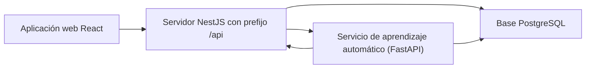

# Servidor de LANCELOT G11V

Este proyecto es la `API` (el servicio que guarda y entrega información a la página web) de LANCELOT G11V. Administra usuarios, temporadas, entrenamiento, salud y progreso deportivo. Está construido con NestJS, una herramienta para organizar los componentes de un servicio web.

## Inicio rápido

Estos pasos son para quien ya instaló los programas, creó la base local y configuró `backend/.env`.

1. En PowerShell o Terminal, dentro de `backend/`, inicia el servicio con `npm run start:dev`. Si funciona, verás mensajes de NestJS y la aplicación iniciada.
2. En el navegador, abre la ruta `/api/docs` en el puerto local 3000. Verás la documentación interactiva de la API.

## Antes de empezar

Necesitas la carpeta completa del proyecto. El espacio de trabajo no tiene un enlace único para descargar todos los proyectos; el enlace para clonar la carpeta completa está **por confirmar**.

| Programa | Versión mínima o recomendada | Descarga oficial |
|---|---|---|
| Node.js, ejecuta JavaScript fuera del navegador | Vite 8 requiere Node 20.19+ o 22.12+. Recomendamos Node 24 LTS. El `package.json` no declara `engines`. | [Descargar Node.js](https://nodejs.org/en/download) · [requisitos de Vite](https://vite.dev/guide/) |
| Docker Desktop, administra programas aislados llamados contenedores | El proyecto no fija una versión; instala la versión estable actual. En Windows revisa los requisitos oficiales de Windows y WSL 2. | [Windows](https://docs.docker.com/desktop/setup/install/windows-install/) · [Mac](https://docs.docker.com/desktop/setup/install/mac-install/) · [Linux](https://docs.docker.com/desktop/setup/install/linux/) |
| Python, necesario para levantar también el servicio de aprendizaje automático | Python 3.12 o posterior compatible; el `Dockerfile` del servicio de aprendizaje automático usa Python 3.12. | [Descargar Python](https://www.python.org/downloads/) |
| Git, descarga y organiza el código fuente | El proyecto no fija una versión mínima; instala la versión estable actual. | [Descargar Git](https://git-scm.com/downloads/) |

Comprueba las instalaciones. Ejecuta cada comando en PowerShell en Windows o en Terminal en Mac/Linux:

1. `node -v` — debe mostrar una versión compatible con Vite 8.
2. `npm -v` — debe mostrar una versión de npm.
3. `docker --version` — debe mostrar la versión de Docker.
4. `git --version` — debe mostrar la versión de Git.
5. Si también levantarás aprendizaje automático: Windows `py -3.12 --version`; Mac/Linux `python3.12 --version` — debe mostrar Python 3.12 o superior.

**Docker:** herramienta que ejecuta la base de datos sin instalarla manualmente. **PostgreSQL:** programa que guarda los datos. El contenedor local de la base se llama `postgres`, como indicó el equipo.

## Para usar el proyecto

## Instalación paso a paso

### 1. Inicia PostgreSQL en Docker

1. Abre Docker Desktop desde el menú de aplicaciones. Espera a que indique que Docker está funcionando.
2. En PowerShell o Terminal, desde cualquier carpeta, comprueba Docker con `docker info`. Debes ver información de las secciones `Client` y `Server`.
3. Si aún no existe el contenedor local, crea uno con este comando. La contraseña del ejemplo es ficticia y solo sirve para una instalación local de prueba:

   `docker run --name postgres -e POSTGRES_DB=lancelot -e POSTGRES_USER=postgres -e POSTGRES_PASSWORD=LancelotLocal2026 -p 5432:5432 --volume lancelot-postgres:/var/lib/postgresql/data -d postgres:16`

   Docker devolverá el identificador del contenedor. El volumen `lancelot-postgres` conserva la base aunque detengas el contenedor.

4. Comprueba que esté activo con `docker ps --filter name=postgres`. Debe aparecer `postgres` con estado `Up`.

Si el contenedor ya existe y está detenido, desde cualquier carpeta ejecuta `docker start postgres`. No vuelvas a ejecutar el comando `docker run` para ese mismo nombre.

Si ya tienes PostgreSQL instalado, puedes usarlo en lugar de Docker. En ese caso, apunta `URL_DB` a esa base y conserva el nombre de base, usuario y contraseña que configuraste.

### 2. Instala el servidor

1. Abre PowerShell en Windows o Terminal en Mac/Linux y entra en la carpeta `backend` del proyecto con `cd backend`.
2. Desde `backend/`, instala las dependencias fijadas en el archivo de bloqueo con `npm ci`. Al terminar, vuelve a aparecer el indicador de la terminal sin errores.
3. Si `backend/.env` no existe, copia la plantilla. En PowerShell usa `Copy-Item .env.example .env`; en Mac/Linux usa `cp .env.example .env`. Si ya existe, no la sobrescribas.
4. Abre `backend/.env` en un editor de texto y configura las variables que aparecen en la tabla siguiente. Los valores de ejemplo son ficticios; usa la misma clave local en el servidor y el servicio de aprendizaje automático.
5. Desde `backend/`, inicia el servicio con `npm run start:dev`. En el primer inicio TypeORM, la herramienta que conecta el servidor con PostgreSQL, crea las tablas; el servidor agrega los cinco roles del sistema. Debes ver mensajes de inicio de NestJS.

### 3. Comprueba el servicio

1. Abre la ruta `/api/docs` en el puerto local 3000.
2. Comprueba que aparezca **Lancelot API** y una lista de rutas agrupadas por tema.

## Configuración: archivo `.env`

Una **variable de entorno** es un dato de configuración guardado fuera del código. Mantén los valores privados dentro de `.env`; nunca subas ese archivo ni copies sus valores a un mensaje o a una captura.

| Variable | Para qué sirve | Qué configurar en local |
|---|---|---|
| `URL_DB` | Conexión del servidor con PostgreSQL. | Conexión a PostgreSQL local: configura host, puerto, usuario, contraseña local y base lancelot |
| `JWT_SECRET` | Firma los tokens de acceso. | `solo-local-cambia-esta-clave-por-una-propia` |
| `JWT_EXPIRES` | Tiempo de vigencia del token de acceso. | `1h` |
| `JWT_REFRESH_EXPIRES_DAYS` | Días de vigencia del token que renueva la sesión. | `30` |
| `CORS_ORIGIN` | CORS (regla que limita qué páginas pueden enviar solicitudes) permite conectar la aplicación web. | origen de la aplicación web que Vite muestra en su terminal |
| `ML_EXPORT_SALT` | Seudonimiza identificadores al exportar variables para análisis; CSV es un archivo organizado en filas y columnas. | `sal-local-ficticia-para-pruebas` |
| `ML_SERVICE_URL` | Origen del servicio de aprendizaje automático. | dirección del servicio de aprendizaje automático en el puerto 8000 |
| `ML_SERVICE_API_KEY` | Clave compartida para llamadas entre el servidor y el servicio de aprendizaje automático. | `ClaveLocalFicticia2026` |
| `ML_SERVICE_TIMEOUT_MS` | Tiempo máximo de espera de llamadas al servicio de aprendizaje automático, en milisegundos. | `10000` |
| `PORT` | Puerto HTTP del servidor; si falta, el código usa el puerto 3000. | `3000` |
| `CLUB_TIMEZONE` | Zona horaria de las fechas y tareas programadas. | `America/Bogota` |

La clave de `ML_SERVICE_API_KEY` debe coincidir con la variable del mismo nombre en `backend/ml-service/.env`. Si todavía no vas a iniciar el servicio de aprendizaje automático, el servidor puede seguir usando sus reglas; no hay necesidad de activar un modelo.

Las descripciones de conexión indican qué datos completar; conserva el formato de .env.example.

## Cómo ejecutarlo y comprobar que funciona

Deja abierta la terminal del servidor mientras lo uses. En el navegador, abre la ruta `/api/docs` en el puerto local 3000. Si la página muestra **Lancelot API** y sus rutas, el servidor respondió.

La aplicación web local usa el puerto 5173. El equipo indica que el servidor se despliega en Railway. El repositorio no contiene la configuración del despliegue.

## Comandos disponibles

Ejecuta los comandos desde la carpeta `backend/`.

| Comando | Para qué sirve | Cuándo usarlo |
|---|---|---|
| `npm ci` | Instala las dependencias exactas del archivo de bloqueo. | Primera instalación o después de cambiar dependencias. |
| `npm run start:dev` | Inicia el servidor y lo reinicia al cambiar código. | Desarrollo local. |
| `npm start` | Inicia NestJS sin modo de espera activa. | Ejecución normal. |
| `npm run start:debug` | Inicia el servidor con herramientas de depuración. | Investigar errores de código. |
| `npm run build` | Compila el servidor en `dist/`. | Revisar una compilación. |
| `npm run start:prod` | Ejecuta el código compilado. | Después de compilar. |
| `npm test` | Ejecuta pruebas unitarias Jest. | Revisar cambios. |
| `npm run test:watch` | Repite pruebas cuando cambian archivos. | Desarrollo de pruebas. |
| `npm run test:cov` | Ejecuta pruebas y calcula cobertura. | Revisar qué código está probado. |
| `npm run test:e2e` | Ejecuta la prueba de extremo a extremo. | Revisar integración del backend. |
| `npm run test:debug` | Inicia pruebas con depurador. | Investigar una prueba. |
| `npm run lint` | Revisa estilo y aplica correcciones automáticas. | Revisión; puede modificar archivos. |
| `npm run format` | Formatea archivos TypeScript. | Antes de entregar código; modifica archivos. |
| `npm run db:roles:check` | Simula la normalización de roles y revierte los cambios. | Antes de normalizar roles en una base existente. |
| `npm run db:roles` | Aplica la normalización de roles. | Solo si la revisión indica IDs incompatibles. |

El servidor crea roles faltantes al iniciar una base nueva; no ejecutes el SQL de normalización como paso de instalación normal. Una **migración** es un cambio versionado que actualiza tablas. El servidor se despliega con `synchronize: true`. El equipo indica que se eligió porque los datos y el desarrollo avanzaron a la par y las modificaciones requerían ajustar el esquema junto con el código. No se encontró un script para cargar datos iniciales; la carpeta `database/` contiene la normalización de roles. No conectes una instalación local a una base de producción.

## Problemas comunes

1. **Docker no está abierto.** La terminal dice que no puede conectarse a Docker. Abre Docker Desktop, espera a que arranque y repite `docker info`.
2. **El puerto 5432 está ocupado.** Docker muestra `address already in use`. Detén el otro servicio PostgreSQL o crea el contenedor con un puerto local libre, por ejemplo `-p 5433:5432`; luego cambia también el puerto de `URL_DB` a `5433`.
3. **El servidor no conecta con PostgreSQL.** NestJS muestra `ECONNREFUSED` o no logra conectar. Comprueba que `docker ps --filter name=postgres` muestre `Up` y que `URL_DB` apunte a `localhost`, el puerto correcto y la base `lancelot`.
4. **Falta `.env` o `URL_DB`.** El servidor informa que no se puede conectar. Copia `.env.example` si falta `.env` y completa `URL_DB` con la configuración local de PostgreSQL.
5. **`npm ci` falla.** La terminal puede mostrar un error de red o de versión. Comprueba `node -v`, instala una versión compatible, verifica la conexión a Internet y repite `npm ci` desde `backend/`.
6. **Hay advertencias por identificadores de roles en una base antigua.** Primero ejecuta `npm run db:roles:check` desde `backend/` y revisa su resultado. Solo si confirma una diferencia, ejecuta `npm run db:roles` sobre una base local respaldada.

## Para desarrolladores

### Estructura

`src/<módulo>/` agrupa controlador, servicio, DTO y entidad. Los módulos principales son autenticación y usuarios; categorías y temporadas; sesiones y cargas; salud y lesiones; alertas; talento; índice de progreso; informes y motor de análisis automático. `src/common/` reúne utilidades compartidas. `database/` contiene el SQL de normalización de roles.

### Arquitectura de carpetas y archivos

| Ruta | Función |
|---|---|
| package.json y package-lock.json | Definen dependencias y comandos; el archivo de bloqueo conserva las versiones instaladas. |
| src/main.ts | Inicia NestJS, aplica el prefijo /api, configura CORS, validación y documentación en /api/docs. |
| src/app.module.ts | Registra módulos y conexión TypeORM con PostgreSQL. |
| src/auth/, src/users/, src/roles/ | Inicio de sesión, cuentas, permisos y roles. |
| src/categories/, src/seasons/, src/competencies/, src/athletes_in_categories/, src/athletes_in_competencies/ | Categorías, temporadas, competencias y asignaciones. |
| src/matches/, src/match_statistics/ | Partidos y estadísticas. |
| src/training_sessions/, src/training_loads/, src/fatigue_alerts/, src/acwr_config/ | Sesiones, cargas, cálculo ACWR (comparación entre la carga reciente y la carga habitual) y alertas de fatiga. |
| src/health_records/, src/parental_consents/, src/injuries/ | Registros de salud, consentimientos y lesiones. |
| src/injury_risk_assessments/, src/injury_risk_rule_config/ | Evaluación de riesgo y configuración de reglas. |
| src/physical_evaluations/, src/technical_evaluations/, src/development_objectives/, src/position_weight_profiles/, src/weighted_progress_index/ | Evaluaciones, objetivos y progreso ponderado. |
| src/talent_flags/, src/talent_rule_config/, src/season_planning/ | Detección de talento, criterios y planificación de temporada. |
| src/ml_features/, src/ml_engine/ | Preparación de variables y comunicación con el servicio de análisis. |
| src/alert_inbox/, src/reports/ | Bandeja de alertas e informes. |
| src/common/ | Utilidades compartidas por los módulos. |
| database/roles.sql y database/run-sql.js | Normalizan roles y ejecutan el SQL. |
| test/ y archivos *.spec.ts | Pruebas automatizadas. |
| .env.example | Plantilla con nombres de configuración; no contiene valores de producción. |

En cada módulo, `*.module.ts` registra sus piezas; `*.controller.ts` declara rutas; `*.service.ts` contiene reglas y operaciones; `entities/` describe tablas y relaciones; `dto/` valida solicitudes y respuestas. Los archivos `*.spec.ts` prueban esas piezas.

### Rutas principales y permisos

Un **endpoint** es una ruta de la API que recibe una acción, como consultar una carga o guardar una sesión. **JWT** es una credencial digital con vencimiento que permite reconocer una sesión. Las rutas empiezan por `/api`. El servidor vuelve a comprobar el rol; ocultar una pantalla en el navegador no reemplaza ese control.

| Rutas principales | Métodos y acceso |
|---|---|
| `/api/auth/login`, `/api/auth/register`, `/api/auth/refresh`, `/api/auth/logout` | `POST`, públicas; inicio de sesión, registro, renovación y cierre de una sesión. |
| `/api/auth/logout-all` | `POST`, requiere JWT; cierra las sesiones del usuario actual. |
| `/api/users`, `/api/users/id/:id` | Lectura y cambios administrativos: `ADMIN`. `/api/users/me` y `/api/users/me/password`: los cinco roles. |
| `/api/categories`, `/api/seasons`, `/api/matches` | Lecturas para roles deportivos y de salud; escrituras limitadas a `ADMIN`, `DIRECTOR_TECNICO` y/o `ENTRENADOR`, según el recurso. |
| `/api/training-sessions`, `/api/training-loads` | Entrenadores administran sesiones; deportistas pueden consultar y registrar su carga. |
| `/api/load-monitoring/acwr/athlete/:id_user`, `/api/load-monitoring/acwr/category/:id_category` | Lectura de seguimiento ACWR; la ruta de categoría no permite `DEPORTISTA`. |
| `/api/fatigue-alerts`, `/api/alerts/inbox` | `ADMIN`, `DIRECTOR_TECNICO`, `ENTRENADOR`, `ENCARGADO_SALUD`. |
| `/api/health-records`, `/api/parental-consents` | `ADMIN` y `ENCARGADO_SALUD`; la auditoría de acceso es solo `ADMIN`. |
| `/api/injuries` | `ADMIN`, `ENCARGADO_SALUD`, `ENTRENADOR`. |
| `/api/progress-index`, `/api/progress-index/ranking` | `ADMIN`, `DIRECTOR_TECNICO`, `ENTRENADOR`; recalcular temporada requiere `ADMIN` o `DIRECTOR_TECNICO`. |
| `/api/talent-flags`, `/api/season-planning/:id_season` | Según acción: `ADMIN`, `DIRECTOR_TECNICO`, `ENTRENADOR`; aplicar un plan requiere `ADMIN` o `DIRECTOR_TECNICO`. |
| `/api/ml/readiness`, `/api/ml/models` | Acceso administrativo y de salud, más llamadas internas del servicio de aprendizaje automático con `x-api-key`. |

Los roles usados son `ADMIN`, `ENTRENADOR`, `DEPORTISTA`, `DIRECTOR_TECNICO` y `ENCARGADO_SALUD`. El servicio de aprendizaje automático también usa la credencial interna `ML_SERVICE`. La lista completa de rutas, métodos y roles está en `.claude/contexto/backend.md` y en `/api/docs` del servidor local.

### Cálculos y tareas

- **RPE** (esfuerzo percibido): valoración del esfuerzo que registra la persona deportista. La carga de una sesión es `RPE × duración en minutos`.
- **ACWR** (relación entre carga aguda y crónica): promedio de carga diaria de los últimos 7 días dividido por el promedio diario de los últimos 28. Por ejemplo, `300 ÷ 250 = 1,20`. Días sin carga cuentan como cero; si la carga crónica es cero, no se calcula. Los límites se configuran por categoría.
- Las alertas de fatiga se recalculan a las 03:00 de `America/Bogota`. El riesgo por reglas se revisa a las 04:00. El servidor también actualiza variables diarias para el servicio de aprendizaje automático a las 05:00.
- El riesgo por reglas puede activarse por ACWR alto sostenido, varias sesiones con RPE alto o una lesión en recuperación junto con ACWR alto. Una regla activada produce riesgo medio; dos o más producen alto. Los umbrales pueden cambiar por categoría.
- El índice ponderado combina puntajes físicos, técnicos, tácticos y de participación. Ejemplo ficticio: `80×0,30 + 70×0,30 + 60×0,20 + 90×0,20 = 75`. Estos pesos son solo un ejemplo; el sistema busca el perfil real por posición y categoría.

Código relacionado: `src/fatigue_alerts/acwr-calculator.service.ts`, `src/fatigue_alerts/fatigue-alerts-cron.service.ts`, `src/injury_risk_assessments/injury-risk-rules.service.ts`, `src/weighted_progress_index/progress-index-calculator.service.ts`, `src/main.ts` y `src/app.module.ts`.

### Pruebas y datos de demostración

Hay pruebas unitarias de Jest y una prueba de extremo a extremo en `test/`. No se encontró una regla de clasificación para cuentas de demostración. El registro asigna el rol `DEPORTISTA`. No uses datos reales de salud en las pruebas locales.

## Cómo se conecta con los otros proyectos

La aplicación web envía solicitudes al servidor. El servidor guarda los datos en PostgreSQL y llama al servicio de aprendizaje automático cuando está configurado. Este servicio consulta los datos de entrenamiento en PostgreSQL y comunica sus resultados al servidor.

No hay archivo `docker-compose`; solo el servicio de aprendizaje automático tiene `Dockerfile`. El equipo indica que el servidor se despliega en Railway, pero los archivos de configuración no están en este repositorio.
