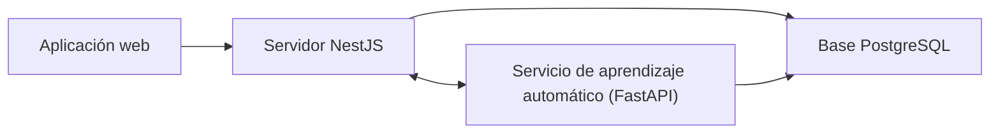

# Servicio de aprendizaje automático de LANCELOT G11V

Este servicio es una API (un programa que recibe solicitudes de otros programas). Recibe datos deportivos del servidor y devuelve resultados de análisis. Docker es una herramienta para ejecutar aplicaciones dentro de contenedores. Esta guía describe el flujo del código; no afirma que haya archivos de resultados disponibles en producción.

## Inicio rápido

Sigue estos pasos después de instalar Python, configurar `backend/ml-service/.env` y encender PostgreSQL y el servidor.

1. En PowerShell, dentro de `backend/ml-service/`, inicia Uvicorn (el programa que ejecuta el servicio) con **.\.venv\Scripts\python.exe -m uvicorn app.main:app --reload --port 8000 --env-file .env**. En Mac/Linux usa **.venv/bin/python -m uvicorn app.main:app --reload --port 8000 --env-file .env**. Verás que Uvicorn queda en ejecución.
2. Abre la ruta `/health` en el puerto local 8000. La respuesta debe mostrar `status: ok`. La ruta informa el estado del servicio.
3. Abre la ruta `/docs` en el puerto local 8000. Verás la lista de acciones del servicio.

## Antes de empezar

Necesitas la carpeta `backend/ml-service/`. La dirección para descargar el espacio de trabajo completo está **por confirmar**. PostgreSQL es el programa que guarda los datos. Docker ejecuta programas aislados en contenedores.

| Programa | Versión mínima o recomendada | Descarga oficial |
|---|---|---|
| Python, ejecuta el servicio y sus cálculos | Python 3.12 o posterior; el Dockerfile usa 3.12. | [Descargar Python](https://www.python.org/downloads/) |
| Node.js, necesario si también ejecutarás el servidor o la página web | Vite 8 requiere Node 20.19+ o 22.12+; se recomienda Node 24 LTS. | [Descargar Node.js](https://nodejs.org/en/download) · [requisitos de Vite](https://vite.dev/guide/) |
| Docker Desktop, opción para ejecutar PostgreSQL o aprendizaje automático en un contenedor | El proyecto no fija versión; instala la versión estable actual. | [Windows](https://docs.docker.com/desktop/setup/install/windows-install/) · [Mac](https://docs.docker.com/desktop/setup/install/mac-install/) · [Linux](https://docs.docker.com/desktop/setup/install/linux/) |
| Git, descarga y organiza el código fuente | El proyecto no fija versión mínima; instala la versión estable actual. | [Descargar Git](https://git-scm.com/downloads/) |

Comprueba las instalaciones en PowerShell (Windows) o Terminal (Mac/Linux):

1. Windows: **py -3.12 --version**; Mac/Linux: **python3 --version**. Debe indicar Python 3.12 o posterior.
2. **node -v** — debe ser compatible con Vite 8 si también levantarás la aplicación web o el servidor.
3. **docker --version** — solo si usarás contenedores.
4. **git --version** — debe mostrar la versión de Git.

## Para usar el proyecto

### Instalación paso a paso

1. Abre PowerShell o Terminal en la raíz del espacio de trabajo y entra a esta carpeta con `cd backend/ml-service`. Debes quedar dentro de `backend/ml-service/`.
2. Crea un entorno aislado de Python. En Windows ejecuta **py -3.12 -m venv .venv**; en Mac/Linux ejecuta **python3 -m venv .venv**. Al terminar aparecerá la carpeta `.venv`.
3. Instala las librerías desde `backend/ml-service/`. En Windows usa **.\.venv\Scripts\python.exe -m pip install -r requirements.txt**; en Mac/Linux usa **.venv/bin/python -m pip install -r requirements.txt**. Espera a que pip termine sin errores.
4. Si no existe `.env`, copia la plantilla. En PowerShell: `Copy-Item .env.example .env`. En Mac/Linux: `cp .env.example .env`. No reemplaces un archivo existente.
5. Abre `.env` en un editor de texto y completa la tabla siguiente. Usa datos ficticios en tu computador. La clave compartida debe coincidir con `ML_SERVICE_API_KEY` en `backend/.env`.
6. Deja PostgreSQL y el servidor encendidos si vas a procesar solicitudes que consultan datos. Inicia el servicio con los comandos de Inicio rápido.

### Configuración: archivo .env

Una **variable de entorno** es un dato de configuración guardado fuera del código. No compartas los valores de .env. Los ejemplos son inventados y solo sirven para desarrollo local.

| Variable | Para qué sirve | Qué configurar en local |
|---|---|---|
| `DATABASE_URL` | Conexión de lectura a PostgreSQL para preparar los datos. | Configura el host, el usuario, el puerto local y la base `lancelot`. |
| `BACKEND_URL` | Dirección base del servidor; el servicio agrega el prefijo `/api` a sus rutas. | Dirección local del servidor en el puerto 3000. |
| `ML_SERVICE_API_KEY` | Clave compartida para autenticar solicitudes entre el servicio y el servidor. | Usa una clave local ficticia y la misma en ambos archivos `.env`. |
| `MODELS_DIR` | Carpeta donde el proceso guarda los archivos que genera. | `./models` |
| `BACKEND_TIMEOUT_SECONDS` | Tiempo máximo que espera una respuesta del servidor. | `10` segundos. |
| `PORT` | Puerto HTTP del servicio; el Dockerfile usa 8000 si falta. | `8000` |

La tabla explica cada variable; conserva el formato de `.env.example`. El servicio consulta PostgreSQL en modo de solo lectura durante el entrenamiento. No incluyas contraseñas reales en documentos ni ejemplos.

### Cómo ejecutarlo y comprobar que funciona

Deja abierta la terminal donde corre Uvicorn. Consulta la ruta `/health` en el puerto 8000; la respuesta debe mostrar `status: ok`. La documentación interactiva está en `/docs` del mismo puerto.

El código prepara variables, recibe solicitudes de entrenamiento y envía el resultado al servidor. Las rutas de estimación usan la versión indicada por el servidor si los archivos necesarios están disponibles. Esta descripción explica el funcionamiento del código; no confirma archivos generados en producción. El servidor conserva sus reglas como alternativa para calcular el riesgo.

### Comandos disponibles

Ejecuta los comandos desde `backend/ml-service/`. Para Python, usa el ejecutable del entorno: Windows **.\.venv\Scripts\python.exe**; Mac/Linux **.venv/bin/python**.

| Comando | Para qué sirve | Cuándo usarlo |
|---|---|---|
| Windows: py -3.12 -m venv .venv; Mac/Linux: python3 -m venv .venv | Crea el entorno aislado. | Primera instalación. |
| Windows: .\.venv\Scripts\python.exe -m pip install -r requirements.txt; Mac/Linux: .venv/bin/python -m pip install -r requirements.txt | Instala las librerías. | Primera instalación o tras cambiar dependencias. |
| Windows: .\.venv\Scripts\python.exe -m uvicorn app.main:app --reload --port 8000 --env-file .env; Mac/Linux: .venv/bin/python -m uvicorn app.main:app --reload --port 8000 --env-file .env | Inicia el servicio y lee .env. | Uso local. |
| Windows: .\.venv\Scripts\python.exe -m pytest; Mac/Linux: .venv/bin/python -m pytest | Ejecuta las pruebas Python. | Revisar cambios. |
| `python scripts/generate_synthetic.py --output data/synthetic_features.csv` | Crea datos ficticios de riesgo en un archivo CSV (datos organizados en filas y columnas). | Ensayar el flujo de entrenamiento. |
| `docker build -t lancelot-ml .` | Construye la imagen Docker. | Ejecución opcional con contenedor. |
| `docker run --name lancelot-ml --env-file .env -p 8000:8000 --volume lancelot-models:/app/models lancelot-ml` | Inicia el contenedor y conserva los archivos que genere el entrenamiento. | Si prefieres Docker al entorno local. |

El proyecto incluye un `Dockerfile`, pero no un archivo `docker-compose`. Si ejecutas el servicio dentro de Docker Desktop y el servidor y PostgreSQL corren fuera del contenedor, cambia `localhost` por `host.docker.internal` en `BACKEND_URL` y en el host de `DATABASE_URL`. Usa la dirección local de la tabla cuando ejecutes el servicio directamente con Python.

## Problemas comunes

1. **No se encuentra Python 3.12.** La terminal dice que python o py no existe. Instala Python desde el enlace oficial y abre una terminal nueva.
2. **La instalación de librerías falla.** Comprueba que Python sea 3.12 o posterior, que haya Internet y que estés en `backend/ml-service/`.
3. **Uvicorn no encuentra app.main.** Aparece el mensaje Could not import module. Entra a backend/ml-service/ y vuelve a iniciar desde allí.
4. **La respuesta dice 401.** La clave no coincide. Compara ML_SERVICE_API_KEY en los dos .env y reinicia ambos servicios.
5. **La ruta de predicción devuelve 503.** El servidor pidió una versión cuyos archivos no están disponibles. Revisa `MODELS_DIR` y el registro que mantiene el servidor. El aviso de datos indica que aún no se cumplen los criterios para iniciar el entrenamiento.
6. **El entrenamiento no conecta con la base.** Comprueba que PostgreSQL esté encendido y que DATABASE_URL apunte a la base correcta. El servidor debe haber creado las tablas de variables.

## Para desarrolladores

**Estimación automática:** cálculo que usa datos registrados para aproximar un resultado futuro. El servicio describe el proceso que ejecuta el código cuando recibe una solicitud; no confirma que haya archivos de entrenamiento disponibles en cada entorno.

### Estructura y versiones

FastAPI organiza la API y Uvicorn la ejecuta. `requirements.txt` declara librerías con versiones mínimas, no exactas: FastAPI >=0.115, Uvicorn >=0.30, pandas >=2.2, NumPy >=2.0, scikit-learn >=1.5, SQLAlchemy >=2.0, psycopg >=3.2, joblib >=1.4 y SHAP >=0.46. pytest y httpx se usan en pruebas. No hay package.json ni pyproject.toml.

- app/main.py: rutas HTTP, clave y coordinación de entrenamiento y predicción.
- app/features.py y app/talent_features.py: variables permitidas y preparación de conjuntos.
- `app/train.py`: ejecuta y evalúa el proceso de entrenamiento cuando el servidor lo solicita.
- `app/predict.py` y `app/explain.py`: procesan solicitudes de estimación y preparan los factores que explican el resultado.
- `app/db.py`: lectura de PostgreSQL; `app/backend_client.py`: consulta criterios de datos y comunica resultados con el servidor.
- `app/config.py`: configuración; `scripts/generate_synthetic.py`: datos ficticios; `tests/`: pruebas.

### Arquitectura de carpetas y archivos

| Ruta | Función |
|---|---|
| requirements.txt | Declara las librerías de Python y sus versiones mínimas. |
| Dockerfile | Construye la imagen desde Python 3.12, instala dependencias, copia app/ y scripts/, y arranca Uvicorn. |
| .dockerignore | Excluye archivos locales que no deben entrar en la imagen. |
| .env.example | Enumera variables necesarias, sin valores privados. |
| app/main.py | Define rutas, valida x-api-key y coordina el flujo. |
| app/config.py | Lee configuración del proceso. |
| app/features.py y app/talent_features.py | Definen variables y preparan los datos de cada tarea. |
| app/db.py y app/backend_client.py | Lee conjuntos de PostgreSQL y consulta o actualiza información de integración en el backend. |
| app/train.py | Entrena y evalúa cuando se solicita el proceso. |
| app/predict.py y app/explain.py | Carga los artefactos requeridos por una solicitud y prepara resultados y factores. |
| app/synthetic.py y scripts/generate_synthetic.py | Generan conjuntos sintéticos de prueba. |
| tests/ | Pruebas de rutas, datos, entrenamiento y resultados. |

### Qué predice y qué datos usa

- El código calcula una estimación de riesgo de lesión sin contacto para los siguientes siete días. Usa variables diarias como edad, cargas de entrenamiento, RPE (esfuerzo percibido por el deportista), sesiones, minutos de partido e historial de lesiones.
- El código también estima el potencial de ascenso deportivo con datos por temporada: índice de progreso, percentil, puntajes, edad, experiencia en el club y lesiones. Para comparar resultados se requiere un ascenso registrado para la temporada siguiente.
- Durante el entrenamiento, el código separa los datos por fecha o temporada para evitar usar información futura. Compara el resultado con las reglas existentes mediante PR-AUC (medida de precisión y cobertura útil cuando hay pocos casos positivos).
- La lectura usa `athlete_daily_features` y `athlete_season_features` de PostgreSQL, en modo de solo lectura. El servidor limita las variables que comparte y no envía nombres ni correos.

Una **etiqueta** es un resultado real registrado que el proceso usa para comparar sus estimaciones. No se revisó el contenido de los datos ni de los archivos generados en un entorno.

### Rutas del servicio

Un **endpoint** es una ruta que recibe solicitudes de otro programa. Todas las rutas, excepto `/health`, requieren la cabecera `x-api-key`.

| Método y ruta | Función |
|---|---|
| `GET /health` | Estado del servicio e indicadores de carga que expone el código. |
| `POST /predict` | Estima riesgo de lesión sin contacto. |
| `POST /talent/predict` | Estima potencial de ascenso. |
| `POST /train` | Ejecuta el proceso de entrenamiento de riesgo con datos de la base o un CSV. |
| `POST /talent/train` | Ejecuta el proceso de entrenamiento de talento con datos de la base o un CSV. |
| `DELETE /models/{version}` | Elimina los archivos locales asociados con esa versión cuando el servidor borra su registro. |

FastAPI muestra la documentación de rutas en `/docs`. El servidor indica qué versión debe procesar una solicitud y recibe el resultado.

### Entrenamiento y límites actuales

El servidor prepara conjuntos diarios para riesgo y conjuntos por temporada para talento. El servicio consulta PostgreSQL, separa los datos por fecha o temporada, procesa el entrenamiento y comunica el resultado al servidor. Este flujo depende de que existan datos suficientes y de que las métricas superen la referencia de las reglas.

CSV es un archivo de datos organizado en filas y columnas. El código marca como sintético el resultado del proceso cuando usa un CSV y el servidor impide activarlo. Esos resultados no representan el rendimiento con deportistas reales. La cantidad y la calidad de los datos afectan las estimaciones. El código no establece un diagnóstico médico ni reemplaza al equipo de salud. Esta guía describe capacidades del código; no afirma que haya archivos generados o activos.

### Construir y ejecutar con Docker

Docker empaqueta el servicio y sus dependencias para ejecutarlo como contenedor. Ejecuta estos comandos en PowerShell o Terminal, desde `backend/ml-service/`.

1. Construye la imagen con **`docker build -t lancelot-ml .`**. Docker mostrará los pasos de construcción y terminará sin errores.
2. Inicia el contenedor con **`docker run --name lancelot-ml --env-file .env -p 8000:8000 --volume lancelot-models:/app/models lancelot-ml`**. La terminal devolverá el identificador del contenedor.
3. Comprueba la ruta `/health` en el puerto `8000`; la respuesta debe mostrar `status: ok`.

El volumen `lancelot-models` conserva los archivos que el proceso genere durante el entrenamiento. Si el servidor y PostgreSQL corren fuera de Docker Desktop, configura BACKEND_URL y el host de DATABASE_URL para que el contenedor los alcance mediante host.docker.internal.

## Cómo se conecta con los otros proyectos

El servidor prepara los datos y consulta este servicio. El servicio de aprendizaje automático también lee PostgreSQL directamente durante el entrenamiento. La aplicación web solo se comunica con el servidor.

El `Dockerfile` también configura internamente `PYTHONDONTWRITEBYTECODE` y `PYTHONUNBUFFERED`; no hace falta agregarlas a `.env`. El equipo indica que el servidor se despliega en Railway. El repositorio no confirma que este servicio se despliegue allí ni cómo conserva los archivos que genera.
